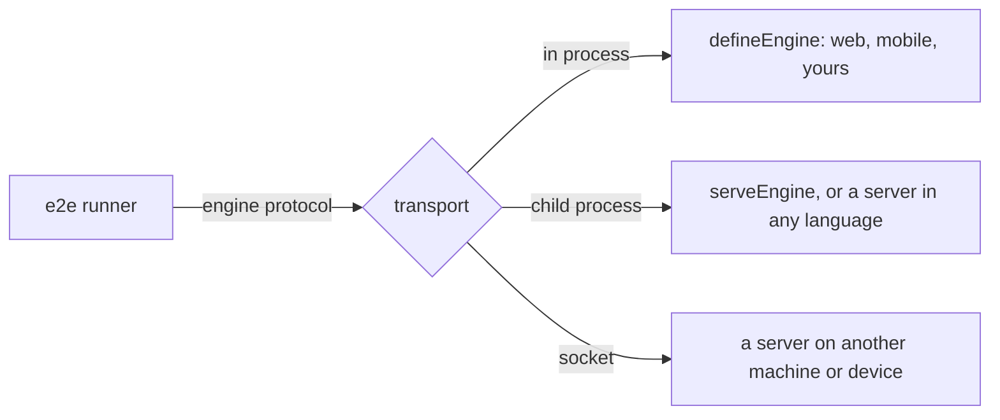

エンジンは、ブラウザ、シミュレーター、TV などのユーザーインターフェースを、
`screen`、`app`、エージェントのために操作します。ランナーは、すべてのエンジンを
[エンジンプロトコル](/reference/engine-protocol) で操作します。これは、エンジンのメンバーごとに 1 つの
JSON-RPC メッセージで構成されます。`@e2e-dev/web` と `@e2e-dev/mobile` もエンジンです。

## 書き方を選ぶ

| 目的 | 書くもの | ガイド |
| --- | --- | --- |
| TypeScript のエンジン | `defineEngine` をターゲットに設定 | [エンジンを書く](/writing-an-engine) |
| 専用のプロセスで動く TypeScript のエンジン | `defineEngine` を `serveEngine` で提供 | [エンジンサーバー](/engine-servers#serve-a-typescript-engine) |
| 別の言語、またはデバイス上のエンジン | プロトコルのメッセージに応答するサーバー | [エンジンサーバー](/engine-servers#write-a-server-in-another-language) |

`defineEngine` で作ったエンジンは、ランナーのプロセス内で実行されます。それでもすべての呼び出しは
プロトコルを経由するため、テストスイートに合格するエンジンは、別の場所にあるサーバーが
受け取れないものを一切必要としません。

## 次のステップ

<CardGroup cols={2}>
  <Card title="エンジンを書く" icon="code" href="/writing-an-engine">
    `defineEngine` でエンジンを一歩ずつ構築します。
  </Card>
  <Card title="エンジンサーバー" icon="network-wired" href="/engine-servers">
    エンジンを別のプロセス、マシン、言語で実行します。
  </Card>
  <Card title="e2e/engine" icon="book" href="/reference/engine">
    エンジンの契約のすべての型とフック。
  </Card>
  <Card title="エンジンプロトコル" icon="book" href="/reference/engine-protocol">
    サーバーが受け取る形での、すべてのメッセージ。
  </Card>
</CardGroup>
